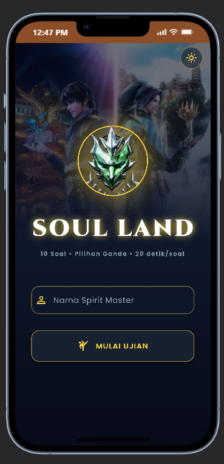
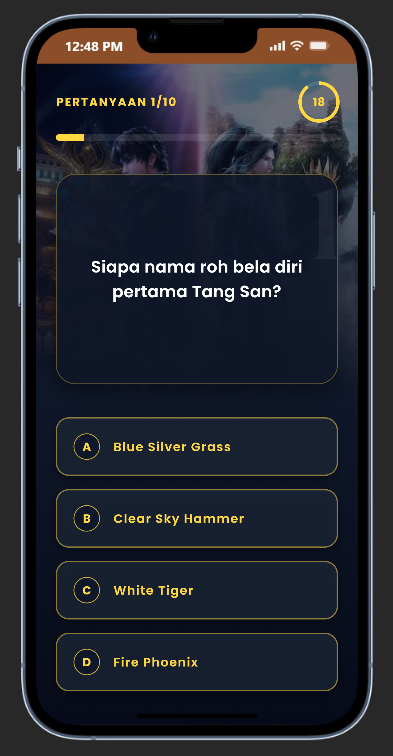
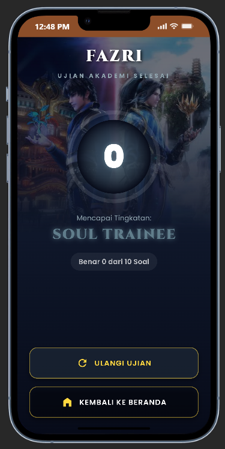
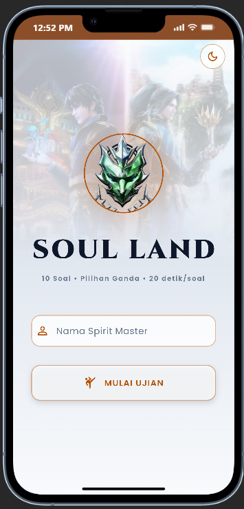
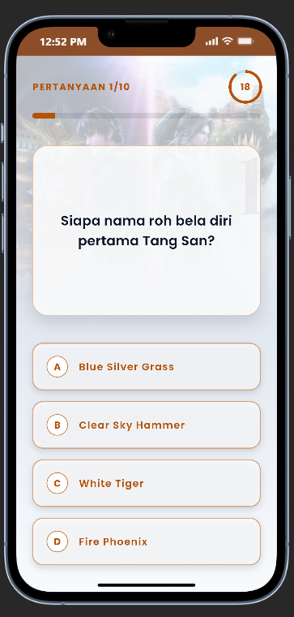
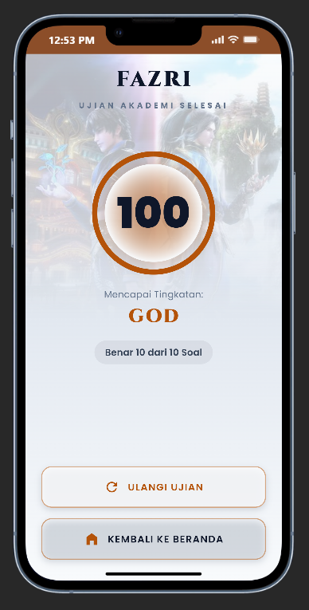

# Kuis Akademi Shrek (Soul Land)

Aplikasi kuis pilihan ganda bertema donghua **Soul Land**, dibuat dengan Flutter untuk UTS Pemrograman Mobile.

## A. Identitas Mahasiswa

| | |
|---|---|
| **Nama** | Ahmad Fazri Berutu |
| **NIM** | 241401015 |
| **Lab** | PM 5 |

## B. Informasi Aplikasi

**Nama Aplikasi:** Kuis Akademi Shrek

**Deskripsi Singkat:** Pengguna memasukkan nama, menjawab 10 soal pilihan ganda seputar dunia Soul Land dengan batas waktu 20 detik per soal, lalu melihat skor akhir beserta tingkatan (rank) yang dicapai.

### Fitur

- Input nama pengguna dengan validasi (tidak boleh kosong, maksimal 20 karakter).
- 10 soal pilihan ganda, 10 poin per jawaban benar.
- Timer 20 detik per soal. Jika waktu habis, soal dianggap salah dan lanjut otomatis.
- Umpan balik jawaban: hijau untuk jawaban benar, merah untuk jawaban yang salah, serta getaran (haptic).
- Progress bar dan indikator timer melingkar.
- Halaman hasil dengan animasi cincin skor dan rank.
- Tombol **Ulangi Ujian** dan **Kembali ke Beranda**.
- Dialog konfirmasi saat pengguna menekan tombol kembali di tengah ujian.
- Dual theme (mode gelap dan terang) lewat tombol di halaman utama.
- Tampilan adaptif untuk ponsel, tablet, dan web: lebar konten dibatasi dan seluruh ukuran UI dihitung dari ukuran layar.
- Transisi antar halaman kustom (fade).

### Tingkatan (Rank)

| Skor | Rank |
|---|---|
| 0 - 20 | Soul Trainee |
| 30 - 50 | Soul Elder |
| 60 - 80 | Soul Emperor |
| 90 | Titled Douluo |
| 100 | God |

## C. Penerapan Kriteria UTS

| Kriteria | Penerapan |
|---|---|
| StatelessWidget dan StatefulWidget | `HomeScreen` adalah StatefulWidget (mengelola `TextEditingController`), widget lainnya StatelessWidget. |
| Minimal 2 halaman dan navigasi | `HomeScreen`, `QuizScreen`, dan `ResultScreen` dengan `Navigator` dan `PageRouteBuilder`. |
| Reusable widget di file terpisah | `lib/widgets/`: `CustomButton`, `AppBackground`, `ThemeToggleButton`, `QuizHeader`, `QuizTimer`, `QuestionCard`, `AnswerOptions`, `ScoreRing`, `showExitDialog`. |
| Aset gambar dan ikon | `assets/images/` dan Material Icons. |
| Font kustom | Poppins dan Cinzel di `assets/fonts/`, dideklarasikan di `pubspec.yaml`. |
| Ukuran UI dinamis | Helper `Responsive` (`lib/utils/responsive.dart`): skala berdasarkan ukuran layar, batas lebar konten, dan ukuran relatif. |
| State management | `provider` (`QuizProvider` dan `ThemeProvider`) di root aplikasi, sehingga skor, nomor soal, dan timer tidak hilang saat layar diputar atau berpindah halaman. |
| Tanpa database | Soal disimpan lokal di `QuizProvider`. |
| GitHub | Riwayat commit per fitur. |
| Bonus | Dual theme dan tampilan adaptif (tablet/web). |

## D. Struktur Proyek

```
lib/
├── main.dart
├── models/
│   ├── question.dart
│   └── rank.dart
├── providers/
│   ├── quiz_provider.dart
│   └── theme_provider.dart
├── screens/
│   ├── home_screen.dart
│   ├── quiz_screen.dart
│   └── result_screen.dart
├── theme/
│   ├── app_fonts.dart
│   ├── app_palette.dart
│   └── app_theme.dart
├── utils/
│   ├── page_routes.dart
│   └── responsive.dart
└── widgets/
    ├── answer_options.dart
    ├── app_background.dart
    ├── custom_button.dart
    ├── exit_dialog.dart
    ├── question_card.dart
    ├── quiz_header.dart
    ├── quiz_timer.dart
    ├── score_ring.dart
    └── theme_toggle_button.dart
assets/
├── fonts/     Poppins, Cinzel (beserta lisensi OFL)
└── images/    poster.jpg, logo_shrek.jpg
docs/
└── screenshots/   home, quiz, result (mode gelap dan terang)
test/
└── widget_test.dart
```

## E. Dokumentasi

### Credit Aset

- **`poster.jpg`:** [IMDb – Soul Land](https://www.imdb.com/title/tt8948436/)
- **`logo_shrek.jpg`:** [Soul Land Wiki (Fandom) – Shrek Academy](https://soulland.fandom.com/wiki/Shrek_Academy/Soul_Land_II)
- Kedua gambar merupakan ilustrasi donghua Soul Land (Douluo Dalu), hak cipta milik pemilik aslinya, dan dipakai hanya untuk keperluan edukasi non-komersial.
- **Font Poppins dan Cinzel:** [Google Fonts](https://fonts.google.com), lisensi SIL Open Font License 1.1 (file lisensi ada di `assets/fonts/`).
- **Ikon:** Material Icons bawaan Flutter.

### Screenshot

| Home | Quiz | Result |
|---|---|---|
|  |  |  |

Tampilan mode terang:

| Home (terang) | Quiz (terang) | Result (terang) |
|---|---|---|
|  |  |  |

### Mockup / Prototype

Mockup dapat dilihat di: [Mockup Kuis Akademi Shrek (Figma)](https://www.figma.com/design/lO9VPg49lXAtv9AKgplpps/Untitled?node-id=1-2&t=eIfYZysSw53XaTmb-1)

## F. Menjalankan Proyek

Prasyarat: Flutter SDK (Dart `>=3.0.0 <4.0.0`).

```bash
git clone https://github.com/AhmadFazriBerutu/241401015_AhmadFazriBerutu_UTSPM5.git
cd 241401015_AhmadFazriBerutu_UTSPM5
flutter pub get
flutter run
```

Menjalankan di browser:

```bash
flutter run -d chrome
```

Menjalankan pengujian:

```bash
flutter test
```